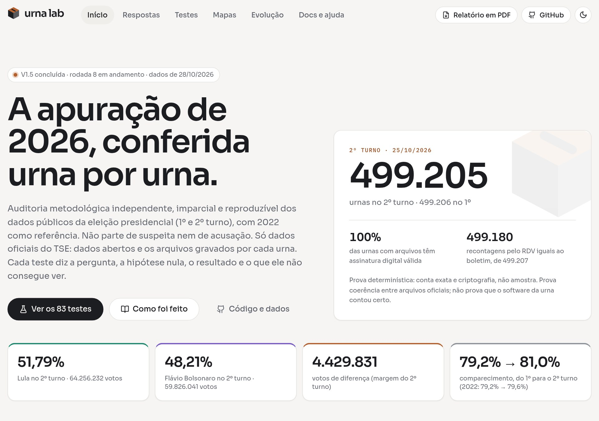
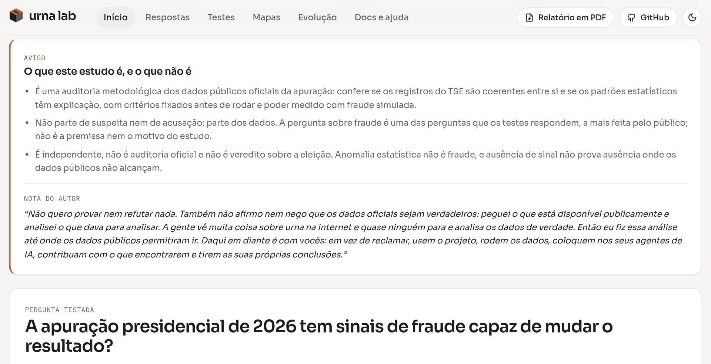
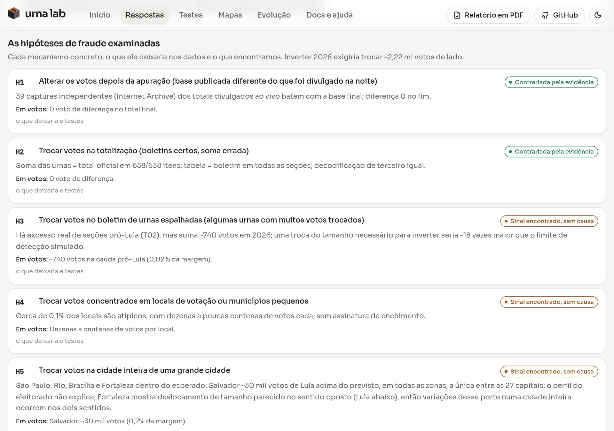
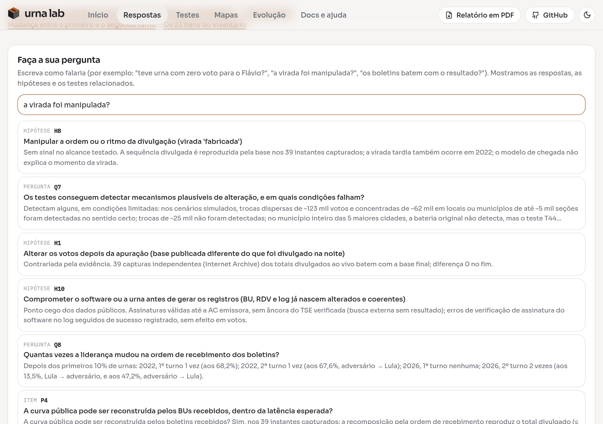
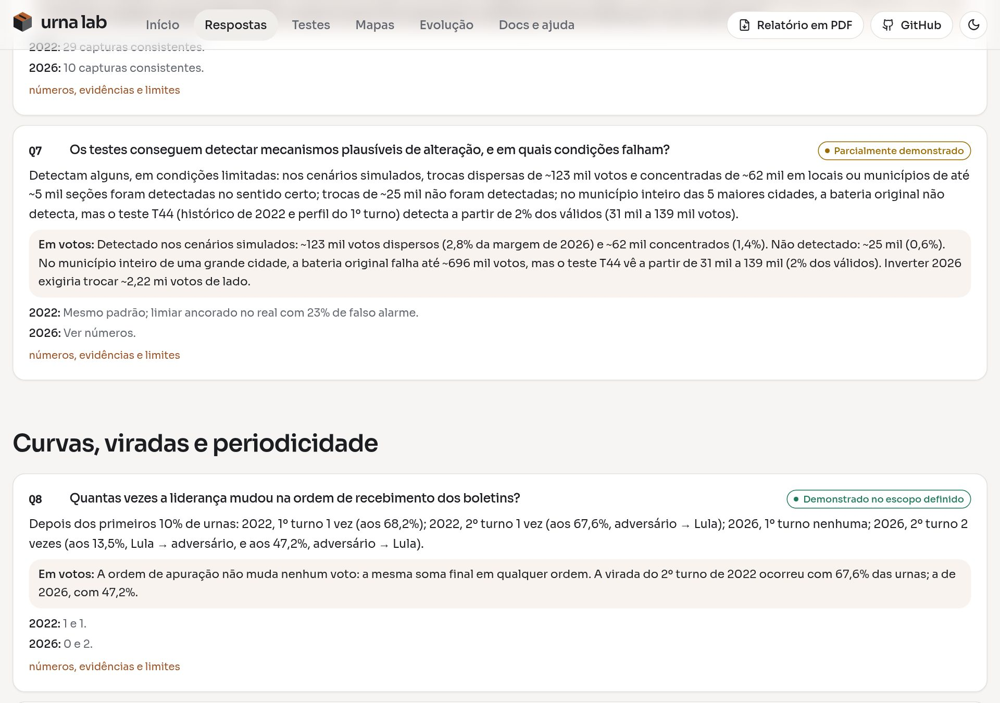
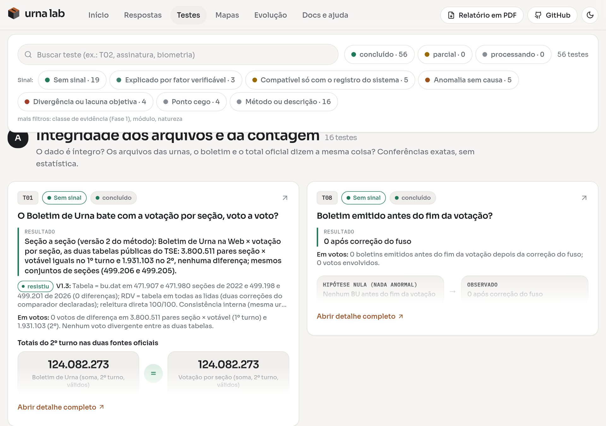
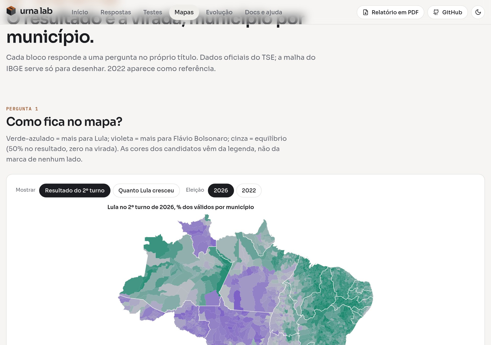
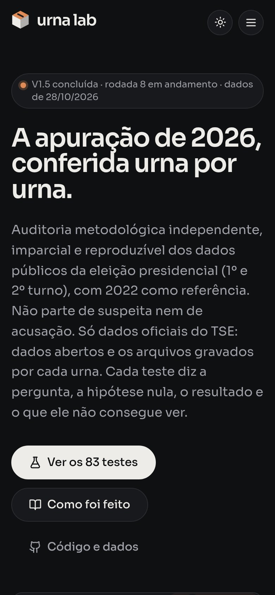

# urna lab

**Auditoria metodológica independente dos dados públicos da apuração presidencial brasileira de 2026** (1º e 2º turno), com **2022** como referência. Usa **somente dados oficiais do TSE**: dados abertos e os arquivos gravados por cada urna (boletim, registro digital do voto, log e assinaturas). São ~405 GB e cerca de 500 mil seções por eleição.

> [!IMPORTANT]
> **O que este estudo é, e o que não é**
>
> - É uma auditoria metodológica dos dados públicos oficiais da apuração: confere se os registros do TSE são coerentes entre si e se os padrões estatísticos têm explicação, com critérios fixados antes de rodar e poder medido com fraude simulada.
> - Não parte de suspeita nem de acusação: parte dos dados. A pergunta sobre fraude é uma das perguntas que os testes respondem, a mais feita pelo público; não é a premissa nem o motivo do estudo.
> - É independente, não é auditoria oficial e não é veredito sobre a eleição. Anomalia estatística não é fraude, e ausência de sinal não prova ausência onde os dados públicos não alcançam.

> [!NOTE]
> **Nota do autor**
>
> Não quero provar nem refutar nada. Também não afirmo nem nego que os dados oficiais sejam verdadeiros: peguei o que está disponível publicamente e analisei o que dava para analisar. A gente vê muita coisa sobre urna na internet e quase ninguém para e analisa os dados de verdade. Então eu fiz essa análise até onde os dados públicos permitiram ir. Daqui em diante é com vocês: em vez de reclamar, usem o projeto, rodem os dados, coloquem nos seus agentes de IA, contribuam com o que encontrarem e tirem as suas próprias conclusões.

**Site:** [urna-lab.web.app](https://urna-lab.web.app) · **Relatório em PDF:** [urna-lab.web.app/relatorio.pdf](https://urna-lab.web.app/relatorio.pdf) (resumo nas primeiras páginas; `make pdf` regera a partir dos JSON) · **Versão:** V1.5, rodada 7, Operação Veracidade Geral (28/10/2026, tag `v1.5`); **rodada 8 (relatório pericial) em andamento, não congelada**; antes, V1.4 com as alegações públicas (tag [`v1.4`](https://github.com/doce42/urna-lab/releases/tag/v1.4)) e Fase 3 em V1.3



## A pergunta testada e a resposta

**Pergunta:** a apuração presidencial de 2026 tem sinais de fraude capaz de mudar o resultado?

**Resposta: não encontramos sinal de fraude nos mecanismos que os dados públicos conseguem examinar, com o poder medido para cada um.** Para inverter o resultado seria preciso trocar **~2,2 milhões de votos** de lado (metade da margem de 4.430.191). Troca dispersa, em locais, zonas ou municípios, de dezenas de milhares de votos deixaria sinal; troca de escala de UF, região ou lote, ou deslocamento uniforme, só seria vista a partir de algumas centenas de milhares a milhões de votos (T63). As anomalias que achamos somam **dezenas de milhares de votos** e não têm causa demonstrada. Isso descreve o que foi achado e não limita o que pode ter passado sem alarme.

Restam **caminhos fora do alcance** dos dados públicos: um deslocamento pequeno e uniforme em quase todas as urnas (H9), uma alteração da urna antes de gerar os registros (H10) e alterações de escala regional, de UF, de lote ou uniformes abaixo de ~0,5 a 2,2 milhões de votos. Para eles, o estudo **não exclui nem confirma**. Só evidência de fora do sistema resolve: boletins impressos de uma amostra sorteada de seções, auditoria independente da urna e a raiz da cadeia de certificados.

> [!WARNING]
> **Leia junto com os resultados**
>
> - O poder de detecção é medido sobre uma base real que pode já conter alteração; o experimento não consegue dizer que a base está limpa.
> - O poder é assimétrico entre os sentidos, por causa da cauda pró-Lula presente na base nos dois anos.
> - Registros internamente coerentes gerados por uma fonte comprometida passam por todas as verificações internas; só evidência de fora distingue.
> - Os 404 boletins de terceiros são uma amostra de conveniência (0,08%).

A dedução passo a passo está em [`fase3/VEREDITO_2026.md`](fase3/VEREDITO_2026.md).



## As 10 hipóteses de fraude

Cada hipótese diz que rastro deixaria, quantos votos precisaria mover e o que os testes encontraram.

| # | Mecanismo | Status | Em votos |
|---|---|---|---|
| H1 | Alterar os votos depois da apuração | Contrariada | 0 voto de diferença: os totais divulgados ao vivo, guardados pelo Internet Archive, batem com a base final; 404 arquivos iguais entre downloads independentes |
| H2 | Trocar votos na totalização (boletins certos, soma errada) | Contrariada | 0 voto de diferença entre boletins, tabela e total oficial; 404 boletins impressos de terceiros iguais ao TSE |
| H3 | Muitos votos trocados em algumas urnas espalhadas | Sinal sem causa | ~740 votos na cauda pró-Lula (0,02% da margem) |
| H4 | Troca concentrada em locais ou municípios pequenos | Sinal sem causa | dezenas a centenas de votos por local |
| H5 | Troca na cidade inteira de uma grande cidade (uma por vez) | Sinal sem causa | Salvador: ~30 mil votos acima do previsto (0,7% da margem) |
| H6 | Encher urnas | Sinal sem causa | ~100 votos com sinal; abaixo de 250 mil votos a bateria não vê enchimento |
| H7 | Apagar votos do adversário (seções zeradas) | **Não determinado (ponto cego)** | nenhum modelo calibrou; de ~44 a ~4.800 votos, se fosse anomalia |
| H8 | Fabricar a ordem ou o ritmo da divulgação | Sem sinal | a ordem não altera nenhum voto |
| H9 | Deslocar um pouco em quase todas as urnas | **Ponto cego** | até ~2,2 mi sem rastro estatístico; em logit, nunca visto (T63) |
| H10 | Comprometer o software ou a urna antes dos registros | **Ponto cego** | sem rastro nos dados públicos; cadeia de certificados verifica em 100% das urnas, sem raiz |

"Sinal sem causa" é uma anomalia real que o estudo não conseguiu explicar. **Não é indício de fraude.** Juntas, somam dezenas de milhares de votos; isso descreve o que foi achado e não limita o que pode ter passado sem alarme.



## Operação Veracidade Geral (28/10/2026, V1.5)

Uma auditoria adversarial do próprio estudo perguntou: **os dados oficiais usados aqui são fiéis ao que aconteceu?** A resposta direta: o que se pôde testar não mostra adulteração; o que não se pôde testar é exatamente a parte que responderia à pergunta. Foram 7 testes novos (T60a a T65) e 9 perguntas (Q42 a Q50).

- **Cadeia de certificados em 100% das urnas (T60a):** 1.942.246 pares seção × turno de 2022 e 2026, 0 falhas, todos válidos no dia, nenhuma chave repetida. Reforça a integridade dos arquivos, não a veracidade dos votos. A raiz do TSE não é pública.
- **404 boletins de terceiros iguais ao TSE (T61):** boletins impressos lidos por terceiros no 2º turno de 2026, em 22 UFs, com assinatura, cadeia e votos iguais em 404 de 404; os mesmos 404 arquivos são idênticos entre downloads independentes. É amostra de conveniência (0,08%).
- **Pontos cegos (T62, T63):** alterações em UFs inteiras, nos cinco grandes municípios juntos, numa macrorregião, num lote tardio ou por deslocamento uniforme só seriam vistas a partir de ~0,5 a 2,2 milhões de votos, ou nunca; registros coerentes gerados pela própria fonte passam em todas as verificações internas; e o poder é assimétrico entre os sentidos.
- **Fato novo:** no 2º turno de 2026 o TSE não registrou recebimento de boletins das 17:07 às 19:03 (116 minutos). Não altera votos; a causa não está nos dados.

O que mudou no veredito por causa disso está em [`operacao_veracidade/09_IMPACTO_NOS_VEREDITOS_ANTERIORES.md`](operacao_veracidade/09_IMPACTO_NOS_VEREDITOS_ANTERIORES.md). O relatório executivo é [`operacao_veracidade/OPERACAO_VERACIDADE_GERAL.md`](operacao_veracidade/OPERACAO_VERACIDADE_GERAL.md); as simulações, [`03_SIMULACOES_ADVERSARIAIS.md`](operacao_veracidade/03_SIMULACOES_ADVERSARIAIS.md); a criptografia, [`02_AUDITORIA_DOCUMENTAL_CRIPTOGRAFICA.md`](operacao_veracidade/02_AUDITORIA_DOCUMENTAL_CRIPTOGRAFICA.md); e a conta do vídeo dos "98% dos votos extras", [`10_HIPOTESE_DO_VIDEO.md`](operacao_veracidade/10_HIPOTESE_DO_VIDEO.md).

## Alegações públicas testadas (rodadas 6 a 8)

As alegações públicas testadas (a live de 2022, o vídeo dos "votos extras" e o relatório pericial) **reproduzem quase todos os números, mas as conclusões não se sustentam**. As três mais comuns:

- **"Duas eleições": Flávio até as 17h00, Lula na prorrogação (T66, Q51).** O corte das 17h00 mistura fusos (as 32.025 seções encerradas antes das 17h00 locais estão em MT, AM, MS, RO, AC e RR, onde o horário legal local é 16h ou 15h) e conta como prorrogação o encerramento de rotina (17:01 a 17:15; 98% das seções fecham até 17:15). A **prorrogação de fato** (depois das 17:30: 7.604 seções, 2,21 mi de votantes) deu a Lula **+228.095 votos de vantagem, 5,1% da margem**; sem essas seções, Lula lidera por 4.202.096.
- **"98,12% dos votos extras foram para Lula" (T65, Q42).** A aritmética está certa, mas o 98% é a premissa de 60% devolvida; o mesmo método dá 370% para Bolsonaro em 2022.
- **Liberação sem biometria de 8,6 milhões (T67, Q53).** Foi menor que em 2022 (6,73% contra 8,06% do comparecimento); a relação com o voto em Lula tem a mesma forma no 1º turno e em 2022 e é nula dentro do mesmo município.

As demais (unanimidades, Benford, microdados, urnas antigas de 2022, boletins parados) estão em [`fase3/VEREDITO_2026.md`](fase3/VEREDITO_2026.md#alegações-públicas-testadas) e nas perguntas Q27 a Q41 e Q51 a Q56 de [`fase3/RESPOSTAS_F3.md`](fase3/RESPOSTAS_F3.md). Q51 a Q56 e T66 a T70 são da rodada 8, ainda não congelada.

## O que você encontra no site

**Pergunte em português.** A busca acha a resposta e o teste que a sustenta, mesmo com outras palavras.



**Toda resposta diz o que significa em votos**, comparado à margem e ao necessário para inverter.



**84 testes com escala de sinal, e 57 perguntas respondidas** (a V1.5, rodada 7, congelou 78 testes e 50 perguntas; a rodada 8, em aberto, acrescenta T66 a T71 e Q51 a Q57). Os testes não são "verdes" ou "vermelhos". Cada um tem um nível de suspeita:

| Nível | Significado |
|---|---|
| S0 | sem sinal |
| S1 | explicado por um fator verificável |
| S2 | compatível só com o registro do próprio sistema (não é verificação independente) |
| S3 | anomalia sem causa |
| S4 | divergência ou lacuna objetiva |
| S5 | indício (nenhum hoje) |
| PC | ponto cego |
| M | método ou descrição (não é sinal sobre a eleição) |



**Mapas** do resultado e da virada por município, em 2026 e 2022.



O site funciona no celular, em tema claro e escuro.

<p align="center"></p>

## Como o estudo trabalha

- **Pré-registro.** Hipótese, modelo nulo e limiar são escritos **antes** de rodar (`PROTOCOLO.md`, `fase3/PREREG_*.md`). Desvios ficam registrados.
- **Calibrado em 2022 e com fraude sintética.** Cada teste tem o poder medido: a partir de quantos votos manipulados ele veria a fraude.
- **Adversarial.** Quando o próprio sistema "explica" uma anomalia (o log da urna, por exemplo), isso conta como **compatível**, não como **verificado**. Evidência de fora do sistema vale mais que coerência interna.
- **Versões congeladas.** Cada versão tem hash SHA-256 de tudo que foi usado, carimbo de tempo no Bitcoin (OpenTimestamps) e linha do tempo (`RODADAS.md`). Erros encontrados ficam documentados com a correção (`CATALOGO.md`).
- **Nem mais nem menos do que foi demonstrado.** Anomalia sem causa não vira fraude, e ausência de sinal não vira prova de ausência onde o dado não alcança.

## Como ajudar

O estudo está aberto a quem quiser contradizer, completar ou repetir. As perguntas abertas, por ordem de impacto:

1. **Boletins impressos de 2026 (H9 e H10).** 404 boletins lidos por terceiros já conferem com o TSE (T61), mas são amostra de conveniência. Falta uma amostra sorteada: fotos de boletins afixados nas seções, com seção identificável, coletadas por fiscais, partidos ou projetos independentes. É o único teste que alcança os dois pontos cegos. Se você conhece um conjunto aberto, abra uma *issue*.
2. **Salvador (H5).** A virada de Lula ficou ~30 mil votos acima do previsto, sem explicação pelo perfil do eleitorado. Fortaleza tem um desvio parecido no sentido oposto no teste por seção. Falta uma causa: campanha local, mudança de zonas, transporte ou outra. Ver `fase3/resultados/final_salvador.json`.
3. **Modelo de chegada dos boletins (H8).** A curva de divulgação ao vivo bate com a base, mas o modelo de chegada não foi validado. Por isso as perguntas sobre a forma da curva ficam indeterminadas (`fase3/resultados/fila_f4_chegada.json`).
4. **Zeros na cauda baixa (H7).** Nenhum modelo calibrou: nem o do R3 nem as três famílias do T64. Um modelo melhor para seções com poucos votos fecharia o item (`fase3/resultados/r3_zeros.json`, `operacao_veracidade/05_ZEROS_E_ENTRE_TURNOS.md`).
5. **Cadeia de certificados (P11).** O certificado de cada urna foi conferido até a autoridade emissora em 100% das urnas (T60a), mas não até a raiz do TSE. O pacote oficial de 2022 traz uma lista de hashes das chaves públicas (`anexo_2179302`) que ainda não foi usada.

Cada pergunta tem o que já foi tentado em [`fase3/RESPOSTAS_F3.md`](fase3/RESPOSTAS_F3.md) e no site, aba *Respostas*. Para propor um teste, veja [CONTRIBUTING.md](CONTRIBUTING.md) e use os modelos de *issue* do repositório.

## Começar sem baixar 405 GB

O release [`v1.3`](https://github.com/doce42/urna-lab/releases/tag/v1.3) traz o **pacote de dados leves** (`dados_leves_v1.3.zip`, 262 MB):

- resultado por seção de 2026 e 2022, nos dois turnos;
- resumo por urna lido dos arquivos das urnas (boletim, RDV, log, assinaturas) e votos por minuto;
- perfil do eleitorado por seção;
- resultados das investigações, o veredito, as respostas e as capturas da divulgação ao vivo;
- o manifesto SHA-256 dos brutos e o `SHA256SUMS` do próprio pacote.

```bash
unzip dados_leves_v1.3.zip -d dados_leves
python exemplos/comecar_com_dados_leves.py   # reproduz a margem, os zeros e as seções extremas
```

> **Preliminar.** O pacote é derivado dos dados oficiais pelo código deste repositório e é atualizado a cada versão. Ele permite repetir boa parte das análises, mas não todas: o que depende dos arquivos brutos das urnas (logs inteiros, assinaturas, imagens) precisa dos dados completos. Detalhes e limites em [`DADOS_LEVES.md`](DADOS_LEVES.md).

## Reproduzir tudo (inclusive com um agente de IA)

Os dados completos **não** estão no repositório; o repositório traz o caminho para baixá-los.

```bash
make ajuda            # lista tudo
make ambiente         # cria o ambiente Python (versões fixas em requirements.txt)
make dados-do-zero    # baixa e prepara os dados oficiais do TSE (horas, ~405 GB)
make verificar        # conferências de sanidade
```

Para saber se um arquivo baixado hoje é o mesmo que o estudo usou, compare o SHA-256 com `dados/listas/MANIFESTO.csv`. O manifesto tem carimbo de tempo no Bitcoin. Ver [`DADOS_PRESERVACAO.md`](DADOS_PRESERVACAO.md).

O projeto é feito para ser continuado por agentes de IA de qualquer modelo: *"Leia `AGENTS.md` e reproduza o estudo"*. O [`AGENTS.md`](AGENTS.md) tem o manual e o estado atual, e [`PIPELINE.md`](PIPELINE.md) tem a ordem de execução e o dicionário de dados. As skills por domínio ficam em `.agents/skills/`, com o mapa em [`MAPA_SKILLS.md`](MAPA_SKILLS.md).

Tudo roda na máquina local: o projeto **não usa GitHub Actions nem Git LFS**.

## Mapa dos documentos

| Arquivo | Para quê |
|---|---|
| [`fase3/VEREDITO_2026.md`](fase3/VEREDITO_2026.md) | **A resposta central**, as 10 hipóteses e a escala de sinal |
| [`fase3/RESPOSTAS_F3.md`](fase3/RESPOSTAS_F3.md) | Cada pergunta respondida, com o impacto em votos |
| [`operacao_veracidade/`](operacao_veracidade/) | Operação Veracidade Geral: auditoria adversarial dos dados e do próprio veredito (comece por `OPERACAO_VERACIDADE_GERAL.md`) |
| [`CONCLUSAO.md`](CONCLUSAO.md) | A conclusão em três níveis: provado, mostrado pela estatística, fora do alcance dos dados |
| `grafico/web/relatorio.pdf` ([no site](https://urna-lab.web.app/relatorio.pdf)) | Relatório em PDF: resumo de 2 a 3 páginas e a parte densa (hipóteses, testes, perguntas, reprodutibilidade), montado dos JSON por `make pdf` |
| [`RODADAS.md`](RODADAS.md) | Evolução da pesquisa: versões congeladas, revisões e a história de cada teste |
| [`fase3/RELATORIO_ADVERSARIAL.md`](fase3/RELATORIO_ADVERSARIAL.md) | Por que coerência com o log não é verificação |
| [`revisoes/`](revisoes/) | Revisões independentes, com achados classificados e respondidos |
| [`DIRETRIZ.md`](DIRETRIZ.md) · [`PROTOCOLO.md`](PROTOCOLO.md) · [`METODOLOGIA.md`](METODOLOGIA.md) | Princípios, critérios fixados antes de rodar e a matemática de cada teste |
| [`AUTOAUDITORIA.md`](AUTOAUDITORIA.md) | Ameaças à validade e lacunas |
| [`CATALOGO.md`](CATALOGO.md) | Linha do tempo, erros encontrados e corrigidos |
| [`DADOS_PRESERVACAO.md`](DADOS_PRESERVACAO.md) · [`DADOS_LEVES.md`](DADOS_LEVES.md) | Como os dados ficam preservados e o pacote leve |
| [`REFERENCIAS.md`](REFERENCIAS.md) · [`CONSUMO_IA.md`](CONSUMO_IA.md) | Bibliografia e quanto de IA o estudo gastou |
| [`testes/registro.json`](testes/registro.json) | Registro de todos os testes, legível por máquina |

## Licença e contribuições

Projeto **livre**: pode baixar, reproduzir, fazer fork, alterar e contradizer.

- **Código:** [MIT](LICENSE)
- **Documentação e resultados:** [CC BY 4.0](LICENSE-DOCS) (cite a fonte)
- **Componentes e dados de terceiros:** [THIRD_PARTY.md](THIRD_PARTY.md)

Para propor mudanças: fork e pull request, validado por quem mantém. Detalhes em [CONTRIBUTING.md](CONTRIBUTING.md).


Relatórios por fase e rodada: [`relatorios/`](relatorios/README.md). Privacidade e medição de acessos: [`PRIVACIDADE.md`](PRIVACIDADE.md).
